
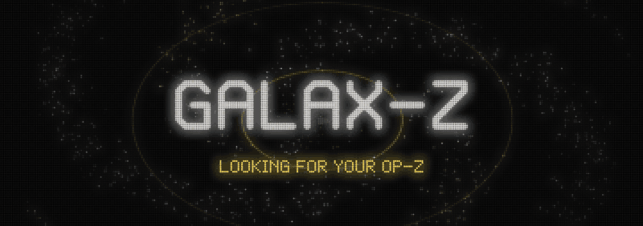

  <b>The screen the OP-Z never had, and an OS for it.</b> 
  An app for iPad, iPhone, Mac and Android that shows and plays your OP-Z, and a set of patches that teach the OP-Z new tricks.

by <b>Luis Tosado</b>

<b>Work in progress.</b> A thank-you to the OP-Z community, and something to build on.

  <a href="docs/USING.md">Use it</a> ·
  <a href="docs/SHORTCUTS.md">Shortcuts</a> ·
  <a href="DISCLAIMER.md">Read this first</a> ·
  <a href="docs/KNOWN-ISSUES.md">Known issues</a> ·
  <a href="docs/WORTH-DOING.md">What to build next</a> ·
  <a href="docs/PORTING.md">Windows and Linux</a> ·
  <a href="CONTRIBUTING.md">Help out</a>

> [!NOTE]
> **This is still being worked on, and every bit of help is welcome.** It started as one person's wish for their own OP-Z, and it stands on what this
> community found out and shared. Sharing it is a way of saying thank you, and of pushing it further together. Take it as a building block: use it,
> fix it, fork it, make something out of it nobody here thought of.
>
> **There are bugs.** The known ones are in [KNOWN-ISSUES.md](docs/KNOWN-ISSUES.md). If you meet another, say so, and if you can fix it, even better. Let's
> build something good.
>
> **Windows and Linux builds are being worked towards.** Much of the code is ready to carry over and [PORTING.md](docs/PORTING.md) says where to begin. If
> that is your thing, you would be a great help.

> [!WARNING]
> **Galax-z OS replaces the operating system of your instrument, and it has only ever run on one OP-Z.** You could end up with an OP-Z that does not
> start. The app works without the OS and then flashes nothing. Read [DISCLAIMER.md](DISCLAIMER.md) before you install the OS.

Not made by, endorsed by or connected with teenage engineering. OP-Z and OP-1 are their trademarks.

## What it does

| | |
|---|---|
| 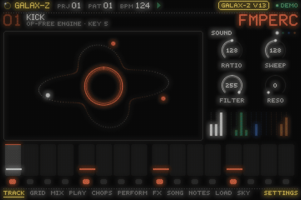 **TRACK**: every sound with its own animation, its dials, its steps | 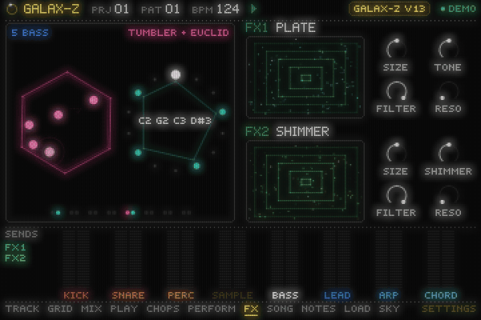 **FX**: both effects, the tumbler, EUCLID |
| 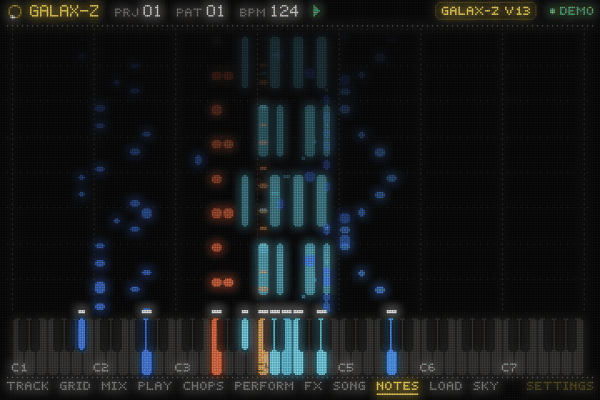 **NOTES**: everything played, over a keyboard | 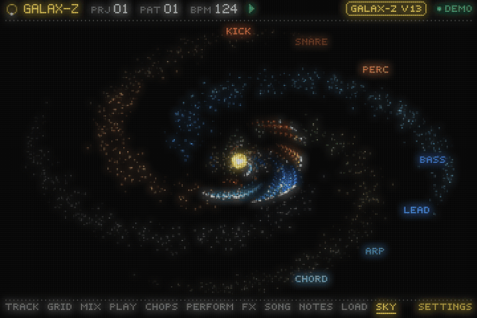 **SKY**: each track is an arm, each note a star |
| 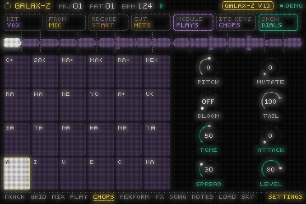 **CHOPS**: a sound cut up, played by the MODULE track | 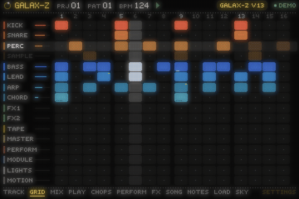 **GRID**: sixteen tracks by sixteen steps |
| 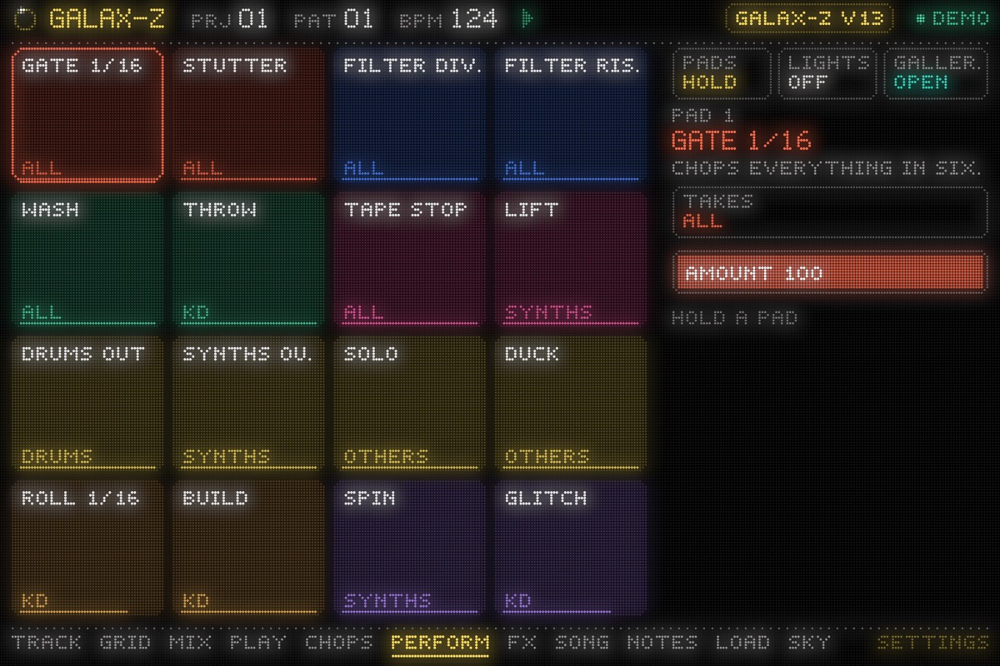 **PERFORM**: gates, sweeps, throws, stops, held on a pad | 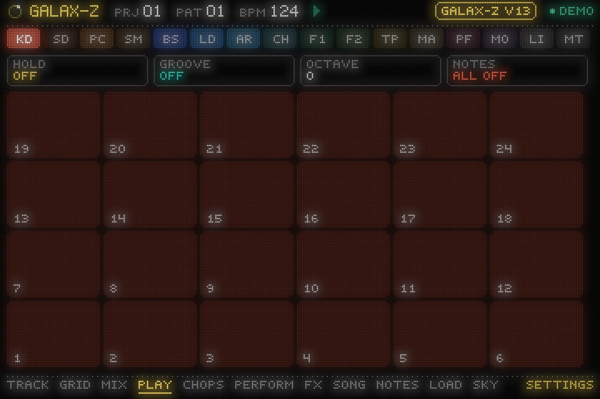 **PLAY**: pads for every track, with scales, chords, grooves |
| 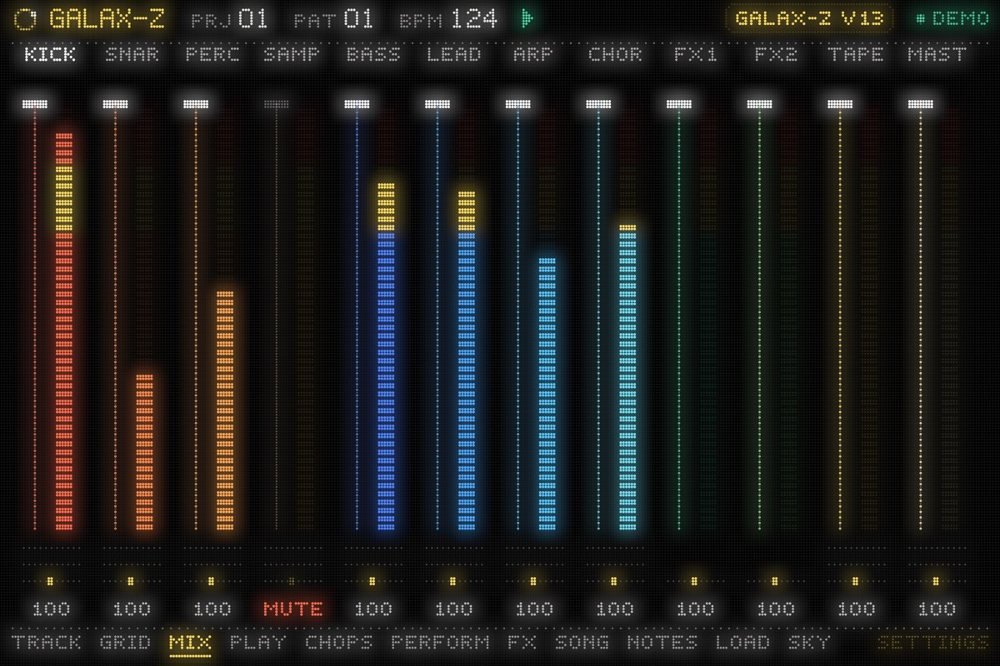 **MIX**: faders, sends, pan, mutes, by touch | 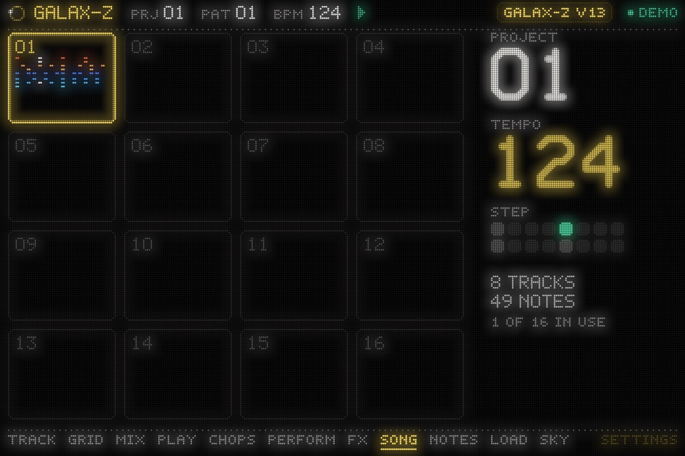 **SONG**: the sixteen patterns, tempo, where you are |

Every picture is the app's own demo. The eleventh page, **LOAD**, shows [how hard the OP-Z works](docs/screens/load.jpg).

**The app** follows the OP-Z over a USB-C cable, or over Bluetooth on iPad, iPhone and Android. Looking sends nothing that changes it; **touching a control
changes the OP-Z by MIDI**, as a knob on it would. It learns any MIDI controller (on a Mac, **Settings › BRIDGE** plays your keyboards and pads straight into the OP-Z, beside its own keys), backs up your projects (reading only), plays the OP-Z's sound through
your device, and, on a Mac, installs Galax-z OS. No OP-Z? **Settings › DEMO OP-Z** plays a pretend one. **On a Mac, try the test build** from [Releases](https://github.com/Luisga521/Galax-z/releases) (not notarized: allow it once in
System Settings › Privacy & Security), or build it with one command ([BUILDING.md](docs/BUILDING.md)). It is not in the App Store. **On Android**, the test
APK is in the same [Releases](https://github.com/Luisga521/Galax-z/releases) (allow installing unknown apps); it is the same screens from the same code,
and a Mac still installs the OS ([Android/README.md](Android/README.md)).

**On the OP-Z itself**, the keys light up when it starts. Six of the sixteen boot animations (Galaxy, Radar, Comet, Rain, Bars, Snake), drawn where the
OP-Z's lights are; each takes your own colours:

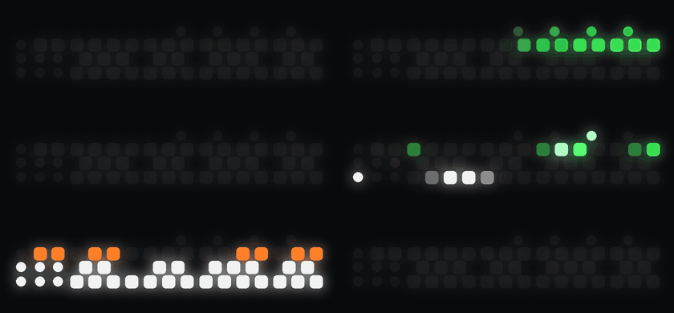

**Galax-z OS** is TE's own 1.2.45, read off *your* OP-Z, with small patches added:

| Since | What it adds |
|---|---|
| v1 | A longer debounce, for keys that trigger twice |
| v2 | A boot animation on the keys: 16 patterns, your own colours |
| v3 | A/B bars: the playhead is white on odd patterns, purple on even ones |
| v4 | **Tumbler**: a pink parameter page. Keys drop balls into a spinning hexagon; their bounces play, and REC records them |
| v5 | **EUCLID**: a teal parameter page of Euclidean rhythms, with a second layer on SHIFT held for 2 s |
| v6 | Older USB keyboards work on the OP-Z as host (made for a Yamaha Motif 6), and a HOST / INSTRUMENT switch |
| v7 | Sustain pedal, modulation wheel, presets that survive a restart |
| v8 | A load meter: see how hard the OP-Z is working |
| v9 | More notes held live: bass 6, lead 10, arp 6, chord 10 |
| v10 | Tells the app where the balls and rings are |
| v11 | **GROOVE**: a seventh page. Kept keys played by one of 69 grooves, through one of 133 progressions. Two Quindar tones at power-on |
| v12 | The tones take the place of TE's start sound |
| v13 | The GROOVE page in light green (it was red) |

v11 to v13 also come *quiet*, without the tones. **Where everything is on the OP-Z: [the shortcuts](docs/SHORTCUTS.md).**

<a href="docs/SHORTCUTS.md">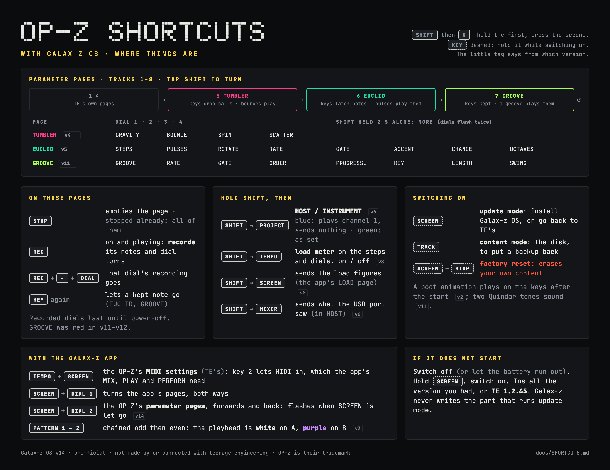</a>

 Two sound engines of ours come with it: a **sampled grand piano** and **OTT**, a three-band compressor. What has been confirmed on the unit
and what has not is in [STATUS.md](docs/STATUS.md), line by line.

## Where to start

| You want to | Go to | Risk to your OP-Z |
|---|---|---|
| Look at it | The Mac or Android test build from [Releases](https://github.com/Luisga521/Galax-z/releases), Settings › DEMO OP-Z | None |
| Use the screen | [USING.md](docs/USING.md) | Very low: looking only reads |
| Play it from the app | [USING.md](docs/USING.md) | Low: MIDI changes what you touch; nothing is written into it |
| Add synths and effects | [OP-FREE](https://github.com/mutlisensor/op-free), the project this stands on | Low: nothing is flashed |
| Install Galax-z OS | [DISCLAIMER.md](DISCLAIMER.md), then [SAFETY.md](docs/SAFETY.md), then [USING.md](docs/USING.md) | **Real** |
| Change the app | [ARCHITECTURE.md](docs/ARCHITECTURE.md), [TESTING.md](docs/TESTING.md) | None, with the virtual OP-Z |
| Write patches for the OS | [The device guide](Firmware/notes/device-guide.md), [Firmware/](Firmware/README.md) | **Real** |
| Help with Windows or Linux | [PORTING.md](docs/PORTING.md) | None, with the virtual OP-Z |
| Fix a bug | [KNOWN-ISSUES.md](docs/KNOWN-ISSUES.md), [CONTRIBUTING.md](CONTRIBUTING.md) | |
| Make it your own | [FORKING.md](docs/FORKING.md) | |

## The documents

| | |
|---|---|
| **Before anything** | [Disclaimer](DISCLAIMER.md) · [Advised / not advised](docs/SAFETY.md) · [Status, confirmed or not](docs/STATUS.md) · [Known issues](docs/KNOWN-ISSUES.md) · [Whose is what](OWNERSHIP.md) |
| **Using** | [Using Galax-z](docs/USING.md) · [Shortcuts](docs/SHORTCUTS.md) · [Building it](docs/BUILDING.md) |
| **Building on it** | [Contributing](CONTRIBUTING.md) · [Worth doing / not worth doing](docs/WORTH-DOING.md) · [Windows and Linux](docs/PORTING.md) · [Forking](docs/FORKING.md) |
| **How it works** | [Architecture](docs/ARCHITECTURE.md) · [What the OP-Z says](docs/PROTOCOL.md) · [Trying it with no OP-Z](docs/TESTING.md) · [Releasing a version](docs/RELEASING.md) · [Galax-z 2, the plan](docs/PLAN-2.md) |
| **The OP-Z itself** | [Device guide](Firmware/notes/device-guide.md) · [Firmware](Firmware/README.md) · [LEDs](Firmware/notes/leds.md) · [Debounce](Firmware/notes/debounce.md) · [Update mode](Firmware/notes/update-write.md) |

## Thanks

- **[OP-FREE](https://github.com/mutlisensor/op-free)** by Lourens Smit and the op-z-engines contributors (MIT). Their research into how the OP-Z
  works, their patch format, their SDK and their reference code are what made this possible. If you like Galax-z, go there too.
- **[Salamander Grand Piano V3](https://github.com/sfzinstruments/SalamanderGrandPiano)** by Alexander Holm (CC BY 3.0), the recordings in the piano.
- **Everybody in the OP-Z community** who took theirs apart, wrote it down and answered questions. This is for you.
- **teenage engineering**, for the instrument.

**Whose is what, file by file: [OWNERSHIP.md](OWNERSHIP.md).** Full notices: [THIRD_PARTY.md](THIRD_PARTY.md). The tumbler, EUCLID, the grooves and progressions, the chops and the look come from **TO-2**, another instrument of mine, which is not public.

## Licence

[MIT](LICENSE), © 2026 Luis Tosado, for what is Galax-z's own. The piano's sample pack is CC BY 3.0. Others' parts keep their own licences ([OWNERSHIP.md](OWNERSHIP.md)).
