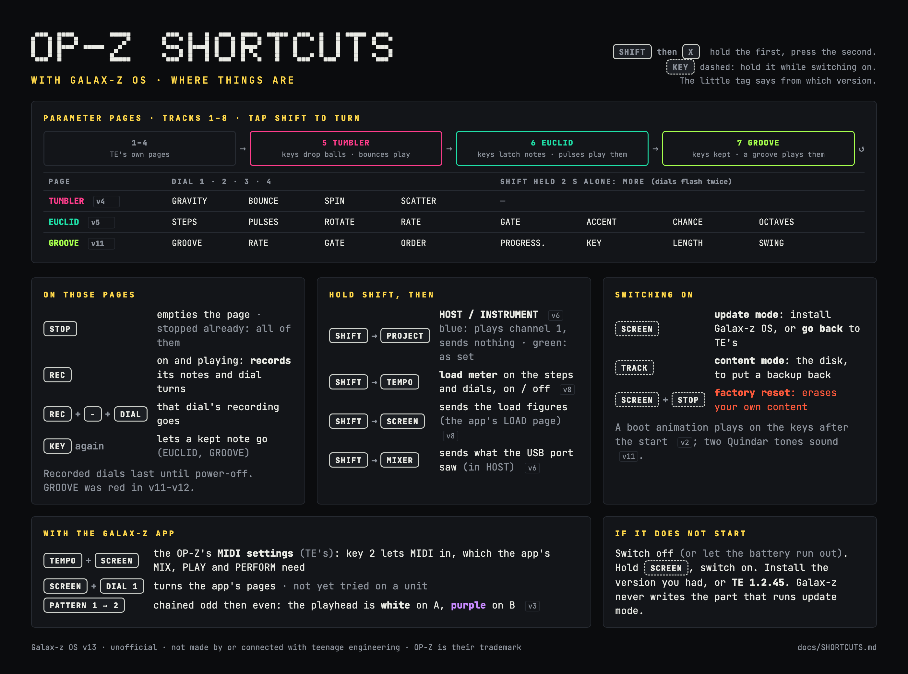

# OP-Z shortcuts, with Galax-z OS

The same, as text. "SHIFT, then X": hold the first, press the second. The version is the first one that has it.

## Parameter pages, tracks 1–8

Tap **SHIFT** to turn the page: TE's four, then three of Galax-z's.

| Page | Since | The keys | Dials 1–4 | SHIFT held 2 s alone: MORE (dials flash twice; again to come back) |
|---|---|---|---|---|
| 5 **TUMBLER**, pink | v4 | drop balls into a spinning hexagon; each bounce plays | GRAVITY, BOUNCE, SPIN, SCATTER | |
| 6 **EUCLID**, teal | v5 | latch notes (again: let go), Euclidean pulses play them | STEPS, PULSES, ROTATE, RATE | GATE, ACCENT, CHANCE, OCTAVES |
| 7 **GROOVE**, light green (red in v11–v12) | v11 | are kept and played by one of 69 grooves | GROOVE, RATE, GATE, ORDER | PROGRESSION, KEY, LENGTH, SWING |

On those pages: **STOP** empties the page (when already stopped: all of them). **REC** on and playing records the notes and the dial turns.
**REC + − + a dial** takes that dial's recording away. Recorded dials last until power-off.

## SHIFT, then

| | | Since |
|---|---|---|
| **SHIFT, then PROJECT** | HOST / INSTRUMENT. Blue: plays channel 1 on the selected track and sends nothing. Green: as the MIDI settings say | v6 |
| **SHIFT, then TEMPO** | The load meter on the step keys and dials, on or off | v8 |
| **SHIFT, then SCREEN** | Sends the load figures (the app's LOAD page) | v8 |
| **SHIFT, then MIXER** | Sends what the USB port saw, in HOST | v6 |

## Switching on

| Hold while switching on | |
|---|---|
| **SCREEN** | Update mode: install Galax-z OS, or go back to TE's |
| **TRACK** | Content mode: the OP-Z's disk, to put a backup back |
| **SCREEN + STOP** | Factory reset. **It erases your own content** |

After the start a boot animation plays on the keys (v2), and from v11 two Quindar tones sound (the *quiet* builds have none).

## With the Galax-z app

| | |
|---|---|
| **TEMPO + SCREEN** | The OP-Z's own MIDI settings. Key 2 lets MIDI in, which MIX, PLAY and PERFORM need |
| **SCREEN + dial 1** | Turns the app's pages. Not yet tried on a unit |
| **Patterns 1 → 2 chained** | The playhead is white on the odd one (A) and purple on the even one (B), v3 |

The picture is made from `Tools/shortcuts/shortcuts.html` by `Tools/shortcuts/render.sh`. Found one that is wrong, or missing? Say so in an issue.
